# Cadavre exquis

[](https://github.com/charlescoiffier/exquis/actions/workflows/ci.yml)


Une application web de **cadavres exquis** à plusieurs, par écrit ou en dessin : chacun joue à son tour sans voir ce qui
précède, sauf la toute fin de la contribution précédente, et l'œuvre complète n'est révélée qu'à la fin de la partie.

**Essayer l'application : pas encore en ligne.** L'application n'est pas déployée publiquement pour l'instant ; elle se
lance sur votre machine en quelques commandes (voir [Démarrage](#démarrage)). Les inscriptions se font sur invitation.

## Aperçu

| Accueil | Écrire un tour (texte) |
|---|---|
| 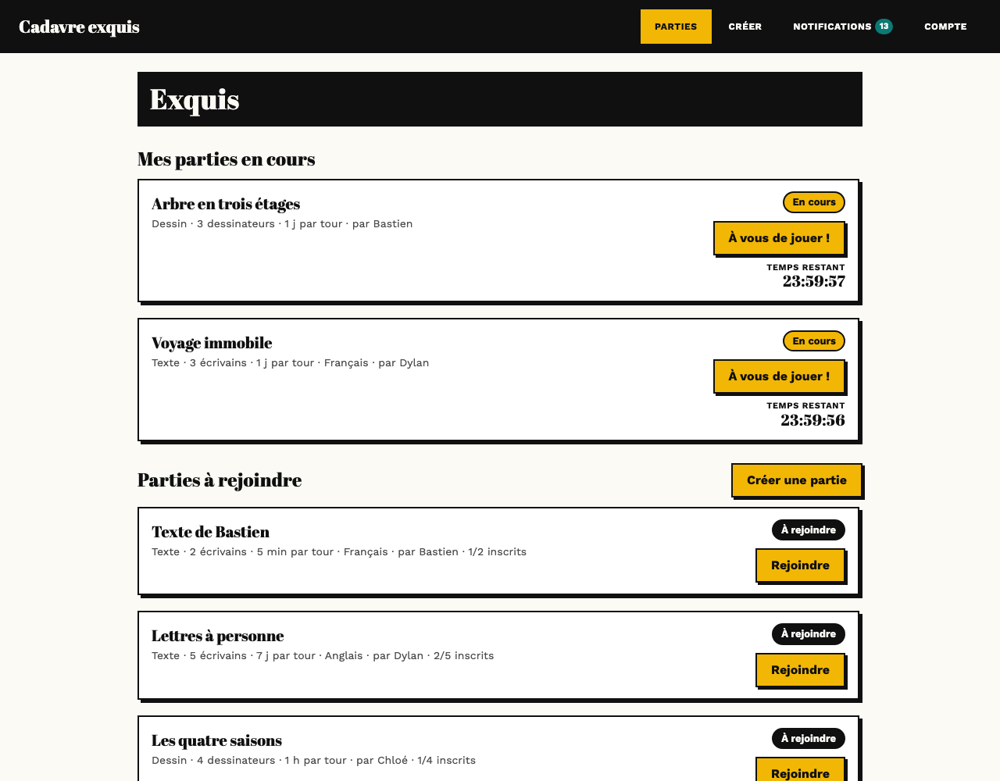 | 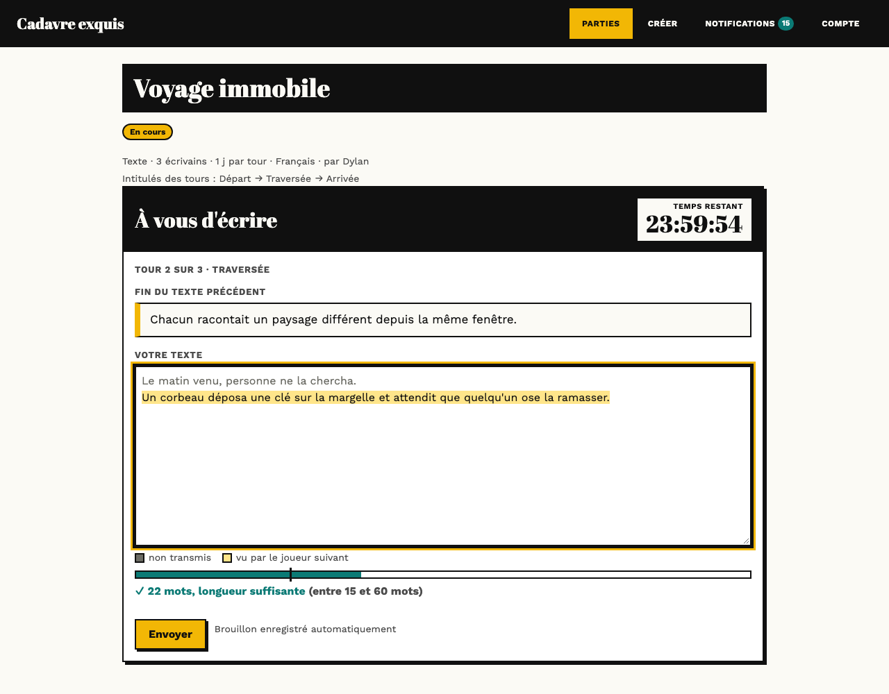 |

| Dessiner un tour | L'œuvre dessinée, avec jointures et noms |
|---|---|
| 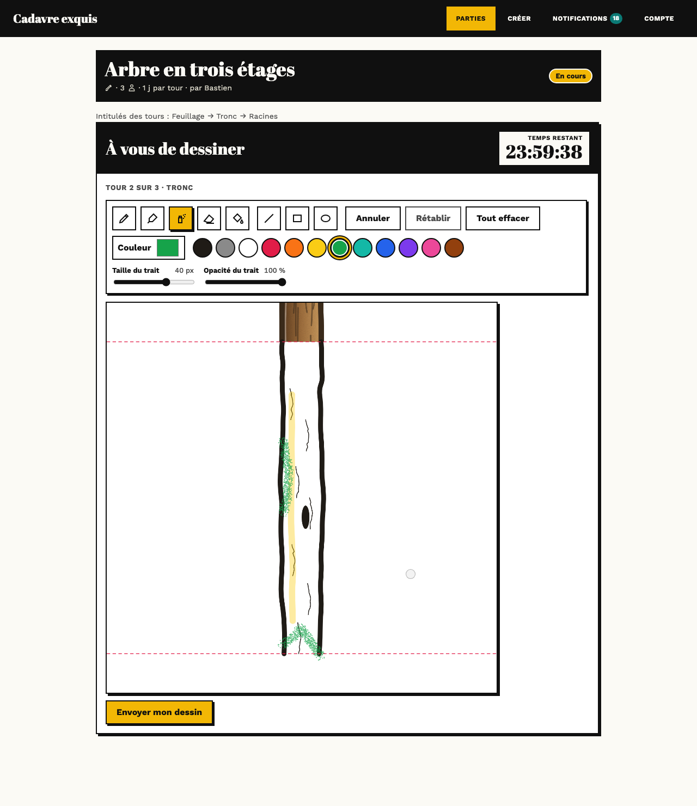 | 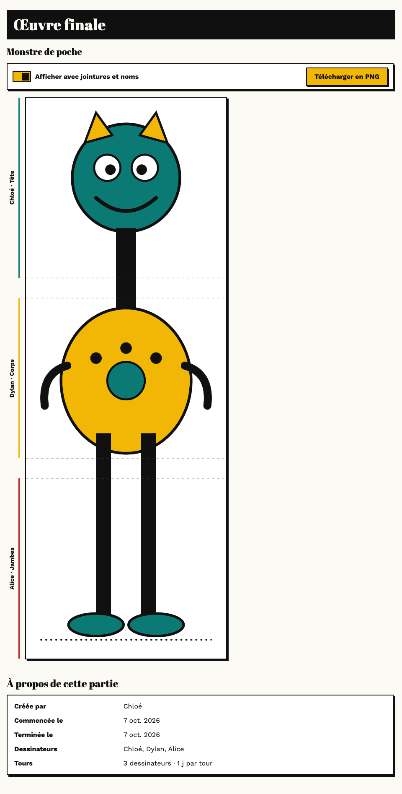 |

| Sur téléphone : accueil | Créer une partie | Écrire | Dessiner | L'œuvre | Mon compte |
|---|---|---|---|---|---|
| 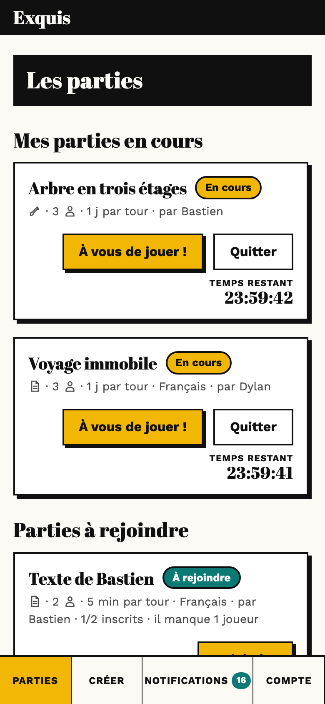 | 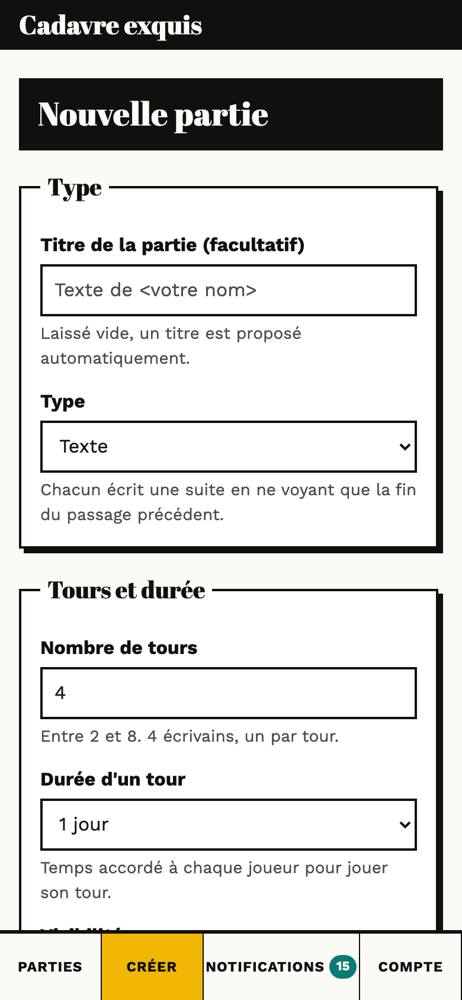 | 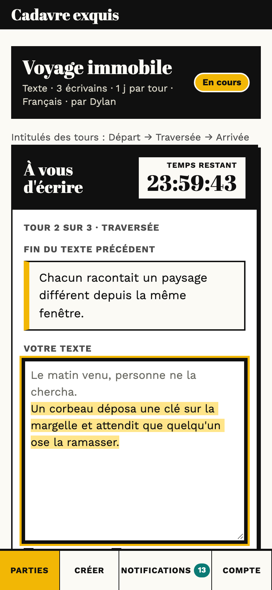 | 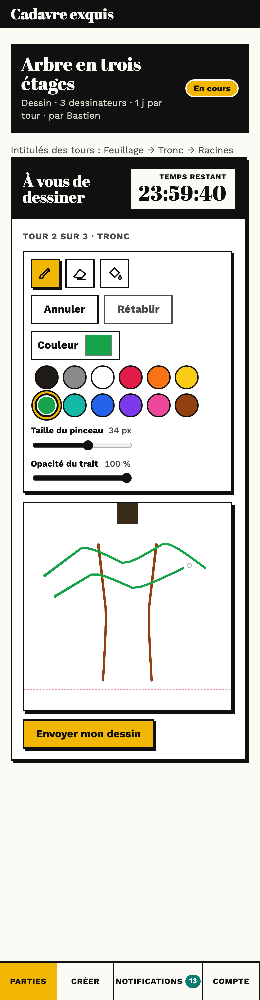 | 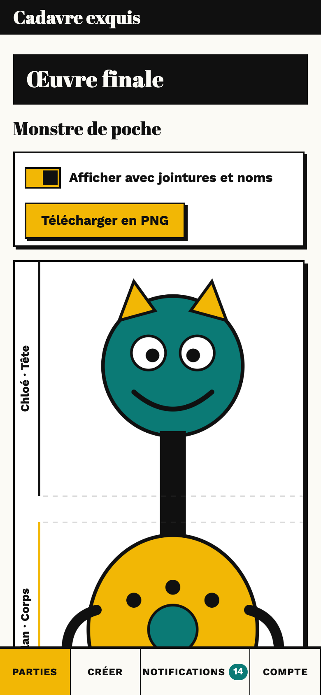 | 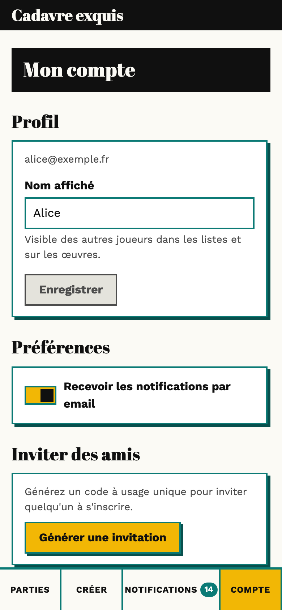 |

L'œuvre d'une partie de texte se présente de la même façon, avec un trait de couleur et le nom de chaque auteur :

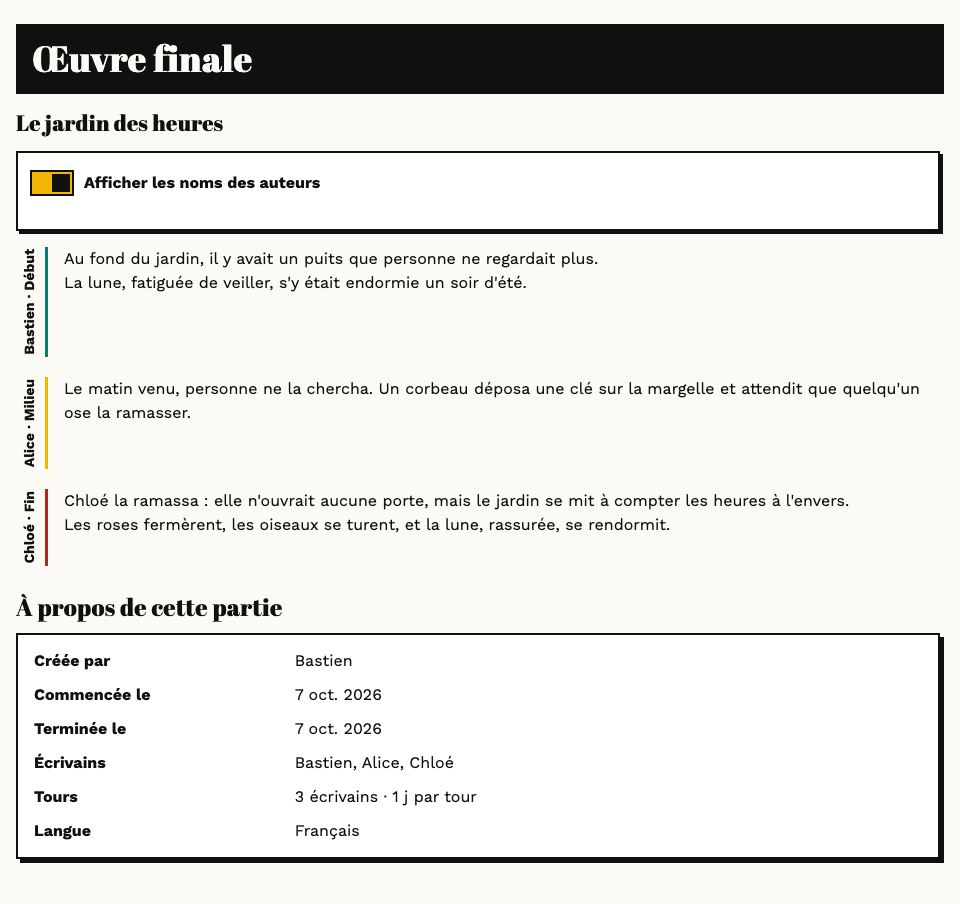

---

# Pour tout le monde

## Le projet en bref

Le **cadavre exquis** est un jeu inventé par les surréalistes vers 1925 : chaque participant écrit (ou dessine) une
partie d'une phrase ou d'une figure sur une feuille pliée, en ne voyant que la fin de ce qu'a fait le précédent. Le
résultat, dévoilé en dépliant la feuille, est toujours un peu absurde et souvent poétique.

Cette application reprend le principe en ligne et **à son rythme** : chaque joueur dispose d'un délai (de quelques
minutes à une semaine) pour jouer son tour, sans avoir à être connecté en même temps que les autres.

## Comment se déroule une partie

1. Quelqu'un **crée une partie** : texte ou dessin, nombre de tours (2 à 8, un joueur par tour), durée d'un tour, et
   éventuellement un titre et un intitulé pour chaque tour (par exemple « tête, corps, jambes, pieds »).
2. Les autres joueurs **la rejoignent** depuis l'accueil, ou par un lien d'invitation si elle est privée.
3. Quand toutes les places sont prises, la partie **démarre** : l'ordre de jeu est tiré au sort.
4. Chacun joue **à son tour**. Un joueur ne voit que la fin de la contribution précédente (la bande de 160 pixels du
   dessin, ou le dernier paragraphe du texte). Il est prévenu quand c'est à lui de jouer.
5. Un tour qui n'est pas joué à temps est **remis en jeu** à un autre joueur.
6. À la fin, **l'œuvre complète** apparaît pour tous les participants, avec le nom de chaque auteur.

## Utiliser l'application

- **Créer un compte** : sur invitation. Chaque joueur peut en générer depuis la page « Mon compte » (5 invitations
  ouvertes au maximum).
- **L'accueil** montre vos parties en cours (« À vous de jouer ! » signale votre tour), les **appels à participation**
  et les parties à rejoindre. Les listes sont paginées par 12, les plus anciennes d'abord. Chaque carte indique le
  créateur, le nombre d'écrivains ou de dessinateurs, la durée d'un tour et la langue. La page se met à jour toute seule
  (toutes les 5 secondes) et l'onglet du navigateur affiche « (1) C'est votre tour » quand c'est à vous.
- **Notifications** : « C'est votre tour », rappel avant l'échéance, tour remis en jeu, partie terminée, œuvre prête.
  Elles sont aussi envoyées par email pour les tours d'au moins 5 minutes (désactivable dans « Mon compte »).
- **Mon compte** : changer son nom, régler la préférence d'email, générer des invitations, se déconnecter, et retrouver
  **« Mes anciennes parties »** (terminées ou annulées, les plus récentes d'abord) : un clic ouvre directement l'œuvre.

### Écrire un tour

Le début de votre tour rappelle la fin du texte précédent. En dessous, votre texte s'écrit dans une zone où la partie
**non transmise est grisée** et la partie **vue par le joueur suivant est surlignée** : c'est exactement ce que le
suivant recevra (le dernier paragraphe, ou les X derniers mots selon la partie). Une jauge indique si la longueur
demandée est atteinte (« ✓ 22 mots, longueur suffisante »). Le brouillon est enregistré automatiquement.

### Dessiner un tour

- La zone de dessin est **carrée**. Les lignes pointillées montrent où le dessin se raccorde : la **bande du dessin
  précédent** apparaît en haut, et ce que vous dessinez dans la dernière bande du bas sera la seule chose que le joueur
  suivant verra de votre travail.
- Outils : **pinceau**, **gomme**, **pot de peinture**, annuler / rétablir, 12 couleurs rapides et un sélecteur de
  couleur libre, **taille** et **opacité** du trait. Un petit cercle gris suit le curseur et montre la taille du pinceau.
- Vous pouvez dessiner **par-dessus la bande du dessin précédent**, mais pas l'effacer : la gomme n'agit que sur vos
  propres traits et le pot de peinture ne remplit jamais la bande.

### Quand le temps est écoulé

À l'échéance, une fenêtre propose de **valider tout de suite** ce que vous avez fait (texte ou dessin) : vous disposez
d'une minute de plus. Passé ce délai, le tour est remis en jeu et votre brouillon n'est plus montré à personne. Si c'est
le **dernier tour** qui n'est pas joué, la partie n'est pas annulée : elle devient un **appel à participation** (📣) que
n'importe quel autre joueur peut reprendre depuis l'accueil.

### L'œuvre finale

L'œuvre rappelle les informations de la partie (créateur, dates, participants, nombre de tours, durée, langue). Pour un
dessin, la case **« Afficher avec jointures et noms »** affiche discrètement les jointures entre les contributions et le
nom de chaque dessinateur le long de sa zone ; **« Télécharger en PNG »** exporte l'image telle qu'elle est affichée
(avec ou sans jointures et noms). Pour un texte, la case « Afficher les noms des auteurs » masque ou affiche le trait et
le nom de chaque auteur.

### Les réglages d'une partie

| Réglage | Valeurs |
|---|---|
| Type | Texte ou dessin |
| Nombre de tours | De 2 à 8 (un joueur par tour) |
| Durée d'un tour | 1 minute, 5 minutes, 15 minutes, 1 heure, 1 jour ou 1 semaine |
| Intitulés des tours | Facultatifs, un par tour (« Tête », « Corps »…) |
| Visibilité | Publique (dans les listes) ou sur invitation (lien) |
| Texte : langue | Français ou anglais |
| Texte : longueur | Mots minimum et maximum de chaque contribution |
| Texte : ce qui est transmis | Le dernier paragraphe, ou les X derniers mots |
| Dessin : sens | Vertical (de haut en bas) ou horizontal (de gauche à droite) |

### Règles à connaître

- Un **mot** est un groupe de caractères séparé par des espaces qui contient au moins une lettre ou un chiffre : la
  ponctuation ou un emoji seuls ne comptent pas.
- Un **paragraphe** est une ligne non vide : chaque retour à la ligne commence un nouveau paragraphe. En mode « dernier
  paragraphe », le suivant reçoit la dernière ligne qui contient un mot, limitée à 150 mots.
- Un joueur peut participer à **5 parties** en cours au plus et en créer **10 par jour**.
- Un tour non joué est remis en jeu au plus **2 fois** ; au-delà, la partie est annulée (sauf pour le dernier tour, qui
  devient un appel à participation). Les contributions d'une partie annulée restent visibles pour ses participants.

---

# Pour les développeurs

## Démarrage

Prérequis : Node.js 22 ou plus, et une base PostgreSQL 16 : Docker (`docker compose`) **ou** la base embarquée de
développement (voir plus bas).

```bash
npm install
cp .env.example .env.local        # puis adapter les secrets
docker compose up -d db           # PostgreSQL (alternative : npm run db:dev, voir plus bas)
npm run db:migrate
npm run dev                       # http://localhost:3000
npm run worker                    # dans un second terminal
```

Pour essayer l'application depuis un smartphone connecté au même Wi-Fi, un seul terminal suffit :

```bash
npm run dev:phone     # serveur + worker, accessibles sur le réseau local
```

La commande détecte l'adresse du Mac, la fixe comme `APP_URL` (connexion et liens d'invitation) et affiche l'adresse à
ouvrir sur le téléphone avec un code d'invitation pour créer un compte. `Ctrl+C` arrête le serveur et le worker. La base
de données doit déjà tourner. Si la page ne s'ouvre pas : vérifier le pare-feu de macOS (autoriser les connexions
entrantes pour Node) et l'absence de VPN ou de Wi-Fi invité qui isole les appareils.

`npm run worker` et `npm run db:migrate` chargent automatiquement `.env.local` s'il existe (option
`--env-file-if-exists`). En production, ces fichiers sont facultatifs : les vraies variables d'environnement suffisent.

```bash
npm test                # tests unitaires et d'intégration (Vitest, vraie base PostgreSQL)
npm run typecheck       # vérification des types
npm run lint
npm run e2e             # test de bout en bout (Playwright)
npm run build           # build de production
npm run capture:readme  # régénère les captures du README (docs/images/) : Chromium requis
```

### Alternative sans Docker : base embarquée

```bash
nohup npm run db:dev > .pgdata.log 2>&1 &
```

Lance un PostgreSQL embarqué (données dans `.pgdata/`, port 5432, bases `exquis` et `exquis_test`). Si une base répond
déjà sur le port 5432, la commande ne fait rien.

### Worker

Le worker (`npm run worker`, pg-boss) expire les tours, envoie les rappels et les emails, assemble les œuvres finales.
Sans lui, les parties n'avancent pas à l'expiration des tours. Il doit tourner en permanence.

## Technologies

[Next.js 15](https://nextjs.org/) (App Router) et TypeScript ; [PostgreSQL](https://www.postgresql.org/) avec
[Drizzle ORM](https://orm.drizzle.team/) ; [Better Auth](https://www.better-auth.com/) pour les comptes ;
[pg-boss](https://github.com/timgit/pg-boss) pour les tâches de fond (expirations, rappels, emails, assemblage) ;
[sharp](https://sharp.pixelplumbing.com/) pour les images côté serveur ; [perfect-freehand](https://github.com/steveruizok/perfect-freehand)
pour le tracé ; stockage local ou S3 ; [Resend](https://resend.com/) pour les emails ; [Vitest](https://vitest.dev/) et
[Playwright](https://playwright.dev/) pour les tests ; polices Abril Fatface et Work Sans (`next/font`).

## Organisation du code

| Dossier / fichier | Rôle |
|---|---|
| `src/app/` | Pages (accueil, partie, œuvre, compte, notifications, connexion) et routes d'API (`/api/**`). |
| `src/components/` | Composants : éditeurs (`TextTurn`, `DrawingEditor`), `TurnEditor` (échéance, fenêtre de validation), `FinalViewer` / `FinalText`, formulaires ; `ui/` : bandeau, onglets, cartes, boutons, pagination. |
| `src/lib/domain/` | Règles pures : mots et paragraphes (`text.ts`), paramètres d'une partie (`game-rules.ts`), décision à l'expiration (`expiry.ts`). |
| `src/lib/services/` | Logique métier sur la base : parties, tours, œuvre finale, notifications, comptes, invitations, envoi d'emails. |
| `src/lib/images/` | Géométrie du dessin (`geometry.ts`), traitement d'images côté serveur (`strip.ts`), mise en page de l'export PNG (`export-layout.ts`). |
| `src/lib/jobs/` | File de tâches pg-boss (`queue.ts`) et traitements (`handlers.ts`) ; `src/worker.ts` est le point d'entrée du worker. |
| `src/lib/storage/` | Stockage des images : mémoire (tests), disque avec URL signées, S3. |
| `src/lib/db/` | Schéma Drizzle, client, migrations ; `drizzle/` contient les migrations SQL. |
| `src/lib/hooks/`, `turn-timing.ts`, `expired-notice.ts` | Rafraîchissement automatique, sauvegarde du brouillon, calcul de la fenêtre de validation côté client. |
| `tests/`, `e2e/` | Tests Vitest (miroir de `src/lib`) et test de bout en bout Playwright. |
| `scripts/` | `create-invite.ts` (première invitation), `dev-db.ts` (base embarquée), `capture-readme.ts` (captures du README). |
| `docs/` | `design/manifeste.md` (charte graphique), `superpowers/` (spécification, plans d'implémentation, suites à donner). |

## Cycle de vie d'une partie

`open` → `in_progress` → `completed` (ou `cancelled`). Un tour passe de `pending` à `active`, puis `done`.

- Au démarrage (dernier siège pris), l'ordre est tiré au sort et le premier tour devient actif avec son échéance.
- À la soumission, le tour suivant devient actif ; après le dernier, la partie est terminée et l'œuvre est assemblée par
  le worker.
- À l'échéance **plus 60 secondes** (fenêtre de validation), le job d'expiration remet le tour en jeu : le joueur est
  échangé avec le prochain joueur en attente. Au-delà de 2 remises en jeu, la partie est annulée. Si c'est le dernier
  tour, il passe en `open_call` (appel à participation) ; un joueur qui n'est pas dans la partie peut le reprendre.
- Chaque transition verrouille la ligne concernée (`FOR UPDATE`) ; les jobs sont idempotents (ils revérifient l'état et
  l'échéance) et un balayage toutes les minutes rattrape les jobs perdus.

## Confidentialité : ce qu'un joueur peut voir

Invariant central : avant la fin de la partie, un joueur ne reçoit jamais plus que la **bande sortante** (dessin) ou
l'**extrait** (texte) du tour précédent. Tout le filtrage est fait côté serveur : `getMyTurn` ne renvoie qu'une URL
signée (5 minutes) vers la bande, ou l'extrait calculé ; les images complètes restent dans un stockage privé ; l'œuvre
n'est lisible que par les participants d'une partie terminée (ou annulée). Les brouillons sont rattachés au tour **et**
au joueur.

## Dessin

La zone est un carré de **1600×1600 px** (`geometry.ts`). La **bande de transition** fait 160 px (10 %) : le serveur
extrait la bande sortante de chaque PNG (`extractStrip`) et ne transmet que celle-là. Pour l'œuvre, `assembleDrawing`
empile les zones propres de chaque tour et recompose, à l'emplacement de la bande sortante du tour précédent, la bande
retouchée par le joueur suivant ; les positions des jointures sont conservées avec l'œuvre. Les lignes pointillées et les
noms ne sont jamais incrustés dans les images stockées : ce sont des calques d'affichage, recomposés dans le navigateur
pour l'export PNG (réduit uniformément au-delà de 16 millions de pixels, limite des canvas mobiles).

Dans l'éditeur, les traits sont gardés sous forme vectorielle (annuler / rétablir, brouillon JSON) et dessinés dans un
calque transparent posé **au-dessus** de la bande héritée ; la gomme efface dans ce calque seulement, et le remplissage
est borné à la zone propre du joueur.

## Texte

`src/lib/domain/text.ts` est la source unique des règles : `countWords` (jetons contenant une lettre ou un chiffre),
`transmittedRange` (indices de la partie transmise dans le texte d'origine) et `extractExcerpt` (le texte transmis).
L'éditeur grise le reste avec `transmittedRange` sur le texte normalisé par `sanitizeText`, exactement comme le serveur.

## Inscriptions et invitations

Les inscriptions sont sur invitation par défaut (`REGISTRATION_MODE=invite`). Pour amorcer la première :

```bash
npx tsx scripts/create-invite.ts
```

Le script affiche un code à saisir sur `/register`. Ensuite, chaque joueur peut en générer depuis « Mon compte »
(5 invitations ouvertes au maximum, valables 7 jours).

| `REGISTRATION_MODE` | Effet |
|---|---|
| `invite` (défaut) | un code d'invitation valide est requis |
| `open` | inscription libre |

Google OAuth n'est volontairement pas inclus : en mode invitation, tout compte passe par `/api/register`. À ajouter si
l'on passe en `REGISTRATION_MODE=open`.

## Variables d'environnement

| Variable | Rôle |
|---|---|
| `DATABASE_URL` | connexion PostgreSQL (obligatoire) |
| `APP_URL` | URL publique de l'application (défaut `http://localhost:3000`) |
| `BETTER_AUTH_SECRET` | secret d'authentification, 32 caractères aléatoires recommandés (`openssl rand -base64 32`) |
| `STORAGE_SECRET` | secret de signature des URLs de stockage local, 16 caractères minimum |
| `REGISTRATION_MODE` | `invite` ou `open` |
| `REQUIRE_EMAIL_VERIFICATION` | `true` (défaut) ou `false` |
| `STORAGE_DRIVER` | `local` (défaut, dossier `STORAGE_DIR`, `.storage`) ou `s3` |
| `S3_ENDPOINT`, `S3_REGION`, `S3_BUCKET`, `S3_ACCESS_KEY_ID`, `S3_SECRET_ACCESS_KEY` | stockage S3 compatible (AWS, Cloudflare R2, Backblaze B2) |
| `RESEND_API_KEY`, `MAIL_FROM` | envoi d'emails ; sans clé, les emails sont écrits dans la console |

## Stockage S3 : CORS

L'éditeur de dessin charge la bande précédente avec `img.crossOrigin = "anonymous"` puis exporte le canvas. Avec
`STORAGE_DRIVER=s3`, le bucket **doit** donc autoriser les requêtes GET depuis l'origine de l'application, faute de quoi
le canvas est « souillé » et l'envoi d'un dessin échoue. C'est une exigence de déploiement. Exemple de règle CORS
(adapter `AllowedOrigins` à `APP_URL`) :

```json
[
  {
    "AllowedOrigins": ["https://exquis.example.com"],
    "AllowedMethods": ["GET", "HEAD"],
    "AllowedHeaders": ["*"],
    "MaxAgeSeconds": 3600
  }
]
```

(Cloudflare R2 : Settings > CORS policy ; AWS S3 : Permissions > CORS ; Backblaze B2 : règles CORS du bucket.)

Avec le stockage local (`STORAGE_DRIVER=local`), les fichiers sont servis par l'application elle-même (même origine) :
pas de CORS. `docker-compose.prod.yml` monte un volume nommé `storage` (`/app/.storage`, `STORAGE_DIR` fixé) partagé par
`web` et `worker` : cela fonctionne sur un seul hôte. S3 est **obligatoire** dès que web et worker tournent sur des hôtes
différents (le worker assemble les œuvres à partir des PNG écrits par le web).

## Déploiement (Docker)

```bash
cp .env.example .env.production   # renseigner DATABASE_URL, APP_URL, secrets, S3, Resend...
export DB_PASSWORD=...            # même mot de passe que dans DATABASE_URL
docker compose -f docker-compose.prod.yml up -d --build
```

`DATABASE_URL` doit pointer vers l'hôte `db`, par exemple `postgres://exquis:<DB_PASSWORD>@db:5432/exquis`. La base a un
healthcheck (`pg_isready`) ; un service one-shot `migrate` applique les migrations, puis `web` (serveur Next.js
standalone, `HOSTNAME=0.0.0.0`) et `worker` (tâches de fond) démarrent une fois la migration terminée. Les services
redémarrent automatiquement (`unless-stopped`) et l'image s'exécute en utilisateur non-root `node`. Mettre un reverse
proxy HTTPS devant le port 3000.

Remarque : le build (y compris `docker build`) télécharge les polices Google (`next/font/google`) ; sans accès réseau,
utiliser `next/font/local`.

Remarque : le `Dockerfile` et `docker-compose.prod.yml` n'ont pas pu être exécutés lors de leur rédaction (pas de démon
Docker disponible) ; seuls la sortie `standalone` et le démarrage de `node .next/standalone/server.js` ont été vérifiés.

### Santé et observabilité

`GET /api/health` renvoie `200` quand la base répond **et** que le worker a terminé un balayage `turn-sweep` il y a moins
de 5 minutes ; sinon `503` avec un JSON `{db, worker, lastSweep}` (sans détail d'erreur ; il est journalisé côté
serveur). Attention : il renvoie 503 tant que le worker n'a pas fait de balayage, ne pas conditionner le démarrage du
worker à cette santé. À brancher sur la supervision (healthcheck, UptimeRobot, etc.). La journalisation se fait sur la
sortie console (`docker compose logs`). Sentry est optionnel et n'est pas installé (il demande un compte et un DSN).

### Sauvegardes

Tâche cron quotidienne sur l'hôte :

```bash
0 3 * * * cd /chemin/vers/exquis && docker compose -f docker-compose.prod.yml exec -T db pg_dump -U exquis exquis | gzip > backup-$(date +\%F).sql.gz
```

Penser à sauvegarder aussi le bucket S3 (ou `.storage` en stockage local) et à tester régulièrement une restauration.

## Tests et intégration continue

```bash
npm test               # Vitest ; nécessite PostgreSQL (base exquis_test)
npm run typecheck
npm run lint
npx playwright install chromium   # une fois
npm run e2e
```

Les tests s'exécutent sur une **vraie base PostgreSQL** (pas de simulation de la base). Le test de bout en bout
(`e2e/text-game.spec.ts`, partie de texte à deux joueurs) démarre `npm run dev` via Playwright, lit `.env.local` et force
`REQUIRE_EMAIL_VERIFICATION=false` ; il utilise la **base de développement** (migrée au préalable) : les comptes et la
partie créés y restent, avec des noms et emails uniques par exécution.

La CI GitHub Actions (`.github/workflows/ci.yml`) lance à chaque pull request et à chaque push sur `main` : typage,
lint, tests et build (job « Typage, lint, tests, build »), puis le test de bout en bout (job « Test de bout en bout »),
chacun avec un PostgreSQL 16 en service.

## Images du README

Les captures de `docs/images/` sont générées par `npm run capture:readme` : le script crée une base jetable
(`exquis_shots`), lance l'application sur le port 3100, joue quelques parties de texte et de dessin par l'API, prend les
captures avec Playwright, puis arrête son serveur et supprime la base. Il demande PostgreSQL (`npm run db:dev` ou
Docker) et Chromium (`npx playwright install chromium`) ; rien n'est écrit dans la base de développement.

## Apparence

L'interface suit la direction visuelle « Manifeste » (affiche surréaliste des années 1920 : aplats, bordures noires de
2 px, ombres dures, titres en Abril Fatface, accents moutarde et vert canard, thème clair). Jetons, composants partagés et
règles d'usage : [`docs/design/manifeste.md`](docs/design/manifeste.md).
